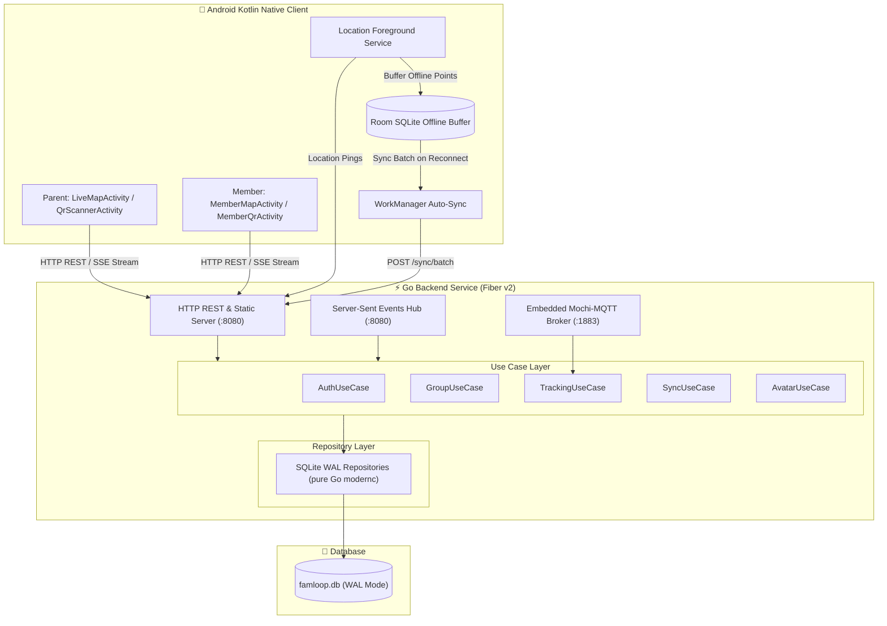

# 📍 FamLoop — Family Real-Time Location Tracking Platform

FamLoop adalah platform pelacakan lokasi keluarga real-time (*family location tracking*) yang tangguh, hemat baterai, dan tahan blokir firewall. Menggabungkan backend berkinerja tinggi berbasis **Go (Fiber v2)** dengan **Clean Architecture** dan database **SQLite WAL (pure Go)**, serta aplikasi mobile **Android Kotlin Native** dengan peta interaktif **Leaflet.js**, sistem avatar kustom/acak, offline-first buffer (Room), dan pairing perangkat via pemindaian QR code hardware.

---

## 🏗️ 1. Arsitektur Sistem

FamLoop dirancang dengan prinsip **Clean Architecture (Dependency Inversion Rule)**:



### Mengapa SSE (Server-Sent Events) Dibanding WebSocket?
| Kriteria | Server-Sent Events (SSE) | WebSocket (WS) | MQTT (TCP 1883) |
|---|---|---|---|
| **Protokol Dasar** | HTTP/1.1 atau HTTP/2 standar | Upgrade TCP kustom | Protokol biner TCP murni |
| **Tembus Firewall / Proxy** | **99.9% Lolos** (dianggap HTTP biasa) | Sering diblokir di firewall korporat/kampus | Port 1883 kerap diblokir ISP |
| **Arah Komunikasi** | Server ke Client (unidirectional stream) | Full-duplex dua arah | Publish / Subscribe broker |
| **Efisiensi Daya HP** | Native HTTP streaming, hemat baterai | Menjaga socket dua arah | Memerlukan client MQTT background |
| **Penggunaan di FamLoop** | **Peta Real-Time Seluruh Anggota & Avatar Event** | — | Jalur cadangan IoT / Hardware GPS |

---

## ✨ 2. Fitur Utama

1. **Registrasi & Otentikasi Orang Tua / Kepala Keluarga**:
   - Akun kepala keluarga dengan `username`, `email`, `phone_number`, dan password (bcrypt).
   - Dilengkapi JWT Bearer token untuk otorisasi endpoint tertutup.
2. **Manajemen Grup Keluarga**:
   - Pembuatan grup keluarga instan (`POST /api/v1/groups`).
   - Kepala keluarga dapat melihat detail anggota, status online, dan persentase baterai.
3. **Hardware QR Code Pairing (Tanpa Akun Tambahan untuk Anak)**:
   - **HP Anak**: Buka aplikasi -> generate QR code instan berisi hardware UUID (`Settings.Secure.ANDROID_ID`), model perangkat, IP lokal (IPv4/IPv6), dan alamat MAC.
   - **HP Orang Tua**: Nyalakan kamera via pemindai QR berbasis CameraX & ML Kit -> scan QR anak -> perangkat langsung terhubung ke grup keluarga.
4. **Offline-First Location Buffering**:
   - Android Room SQLite menyimpan koordinat saat perangkat offline (mode pesawat / tanpa sinyal).
   - Begitu internet tersambung kembali, Android `WorkManager` secara otomatis mengunggah titik ke endpoint `POST /api/v1/tracking/sync/batch`.
   - Backend menggunakan indeks komposit unik `idx_loc_dedup (device_id, recorded_at)` untuk menjamin tidak ada duplikasi data.
5. **Peta Interaktif Leaflet.js dengan Custom Avatar Bubbles**:
   - Peta bebas biaya 100% tanpa API Key Google Maps menggunakan OpenStreetMap tile layer.
   - **12 Karakter Random Default**: Jika belum ada foto, sistem otomatis menetapkan avatar kartun acak (`char_lion`, `char_bear`, `char_cat`, `char_fox`, dll).
   - **Upload Foto Profil (PP)**: Baik orang tua maupun anak dapat mengunggah foto profil kustom via endpoint multipart form-data.
   - Perubahan avatar disiarkan langsung melalui event SSE `MemberAvatarUpdated` sehingga marker di peta seluruh keluarga seketika berganti.
   - Menampilkan badge indikator baterai perangkat dan status online/offline.

---

## 🗄️ 3. Skema Database (SQLite WAL Mode)

Database menggunakan driver pure Go `modernc.org/sqlite` tanpa ketergantungan toolchain CGO:

```sql
PRAGMA journal_mode = WAL;
PRAGMA busy_timeout = 5000;
PRAGMA foreign_keys = ON;

-- 1. Pengguna (Orang Tua / Kepala Keluarga)
CREATE TABLE IF NOT EXISTS users (
    id TEXT PRIMARY KEY,
    username TEXT NOT NULL UNIQUE,
    email TEXT NOT NULL UNIQUE,
    phone_number TEXT NOT NULL UNIQUE,
    avatar TEXT DEFAULT '',
    password_hash TEXT NOT NULL,
    created_at DATETIME DEFAULT CURRENT_TIMESTAMP,
    updated_at DATETIME DEFAULT CURRENT_TIMESTAMP
);

-- 2. Grup Keluarga
CREATE TABLE IF NOT EXISTS family_groups (
    id TEXT PRIMARY KEY,
    name TEXT NOT NULL,
    parent_id TEXT NOT NULL,
    invite_code TEXT UNIQUE,
    created_at DATETIME DEFAULT CURRENT_TIMESTAMP,
    FOREIGN KEY (parent_id) REFERENCES users(id) ON DELETE CASCADE
);

-- 3. Perangkat Anggota Keluarga (Anak / Kerabat)
CREATE TABLE IF NOT EXISTS member_devices (
    id TEXT PRIMARY KEY,
    group_id TEXT NOT NULL,
    device_uuid TEXT NOT NULL,
    device_name TEXT NOT NULL,
    avatar TEXT DEFAULT '',
    ipv4 TEXT,
    ipv6 TEXT,
    mac_address TEXT,
    battery_level INTEGER DEFAULT 100,
    is_active INTEGER DEFAULT 1,
    paired_at DATETIME DEFAULT CURRENT_TIMESTAMP,
    last_seen_at DATETIME,
    UNIQUE(group_id, device_uuid),
    FOREIGN KEY (group_id) REFERENCES family_groups(id) ON DELETE CASCADE
);

-- 4. Riwayat Titik Lokasi
CREATE TABLE IF NOT EXISTS location_history (
    id INTEGER PRIMARY KEY AUTOINCREMENT,
    device_id TEXT NOT NULL,
    group_id TEXT NOT NULL,
    latitude REAL NOT NULL,
    longitude REAL NOT NULL,
    accuracy REAL DEFAULT 0.0,
    speed REAL DEFAULT 0.0,
    heading REAL DEFAULT 0.0,
    recorded_at INTEGER NOT NULL,
    synced_at DATETIME DEFAULT CURRENT_TIMESTAMP,
    FOREIGN KEY (device_id) REFERENCES member_devices(id) ON DELETE CASCADE,
    FOREIGN KEY (group_id) REFERENCES family_groups(id) ON DELETE CASCADE
);

-- Indeks Performa & Anti-Duplikasi
CREATE INDEX IF NOT EXISTS idx_loc_group_time ON location_history(group_id, recorded_at DESC);
CREATE INDEX IF NOT EXISTS idx_loc_device_time ON location_history(device_id, recorded_at DESC);
CREATE UNIQUE INDEX IF NOT EXISTS idx_loc_dedup ON location_history(device_id, recorded_at);
```

---

Base URL:
- **Production**: `https://famloop.my.id`
- **Lokal**: `http://localhost:8080` (atau IP LAN Anda)

### A. Otentikasi & Akun Orang Tua
| Method | Endpoint | Otorisasi | Deskripsi |
|---|---|---|---|
| `POST` | `/api/v1/auth/register` | Public | Mendaftarkan akun orang tua baru |
| `POST` | `/api/v1/auth/login` | Public | Login akun & mendapatkan JWT token |
| `GET` | `/api/v1/auth/me` | Bearer Token | Mengambil profil orang tua yang login |
| `PUT` | `/api/v1/auth/me` | Bearer Token | Memperbarui profil (username, email, phone) |
| `POST` | `/api/v1/auth/avatar` | Bearer Token | Mengunggah foto profil orang tua (multipart `avatar`) |

### B. Grup Keluarga & Perangkat Anggota
| Method | Endpoint | Otorisasi | Deskripsi |
|---|---|---|---|
| `POST` | `/api/v1/groups` | Bearer Token | Membuat grup keluarga baru |
| `GET` | `/api/v1/groups` | Bearer Token | Melihat daftar grup milik orang tua |
| `GET` | `/api/v1/groups/:id` | Bearer Token | Melihat detail grup dan seluruh perangkat anggota |
| `DELETE` | `/api/v1/groups/:id` | Bearer Token | Menghapus grup keluarga |
| `POST` | `/api/v1/groups/:id/pair-device` | Bearer Token | Menghubungkan perangkat via payload scan QR |
| `DELETE` | `/api/v1/groups/:id/members/:device_id` | Bearer Token | Menghapus perangkat anggota dari grup |
| `GET` | `/api/v1/devices/:id` | Public | Mengambil data perangkat anggota berdasarkan ID |
| `POST` | `/api/v1/devices/:id/avatar` | Public | Mengunggah foto profil perangkat anak (multipart `avatar`) |

### C. Pelacakan Lokasi, Offline Sync & Streaming SSE
| Method | Endpoint | Otorisasi | Deskripsi |
|---|---|---|---|
| `POST` | `/api/v1/tracking/ping` | Public | Ingest 1 titik lokasi real-time dari hp anggota |
| `POST` | `/api/v1/tracking/sync/batch` | Public | Sinkronisasi batch koordinat saat hp kembali online |
| `GET` | `/api/v1/groups/:id/locations/latest` | Public | Mengambil posisi terakhir seluruh anggota grup |
| `GET` | `/api/v1/groups/:id/members/:device_id/history` | Public | Mengambil riwayat jejak perjalanan perangkat |
| `GET` | `/api/v1/groups/:id/sse` | Public | Stream SSE real-time lokasi (`LocationUpdated`, `MemberAvatarUpdated`) |
| `GET` | `/uploads/*` | Public | Penyajian file statis foto profil avatar |
| `GET` | `/health` | Public | Service health check |

---

## 💻 5. Contoh Payload

### 1. Register Orang Tua (`POST /api/v1/auth/register`)
```json
{
  "username": "bapak_budi",
  "email": "budi@famloop.id",
  "phone_number": "081234567890",
  "password": "PasswordRahasia123!"
}
```

### 2. Pairing Hasil Scan QR (`POST /api/v1/groups/:id/pair-device`)
```json
{
  "device_uuid": "hw-android-998877",
  "device_name": "Samsung Galaxy A54",
  "ipv4": "192.168.1.45",
  "ipv6": "fe80::1ff:fe00:3a60",
  "mac_address": "00:1a:2b:3c:4d:5e",
  "battery_level": 92
}
```

### 3. Ping Lokasi Real-Time (`POST /api/v1/tracking/ping`)
```json
{
  "device_id": "76da8e86-12a3-4812-9c31-897db67c61bf",
  "group_id": "42ba912a-89a1-4221-a39c-567e9182a101",
  "latitude": -6.2088,
  "longitude": 106.8456,
  "accuracy": 4.5,
  "speed": 12.3,
  "battery_level": 89,
  "recorded_at": 1728574800000
}
```

### 4. Sinkronisasi Batch Offline (`POST /api/v1/tracking/sync/batch`)
```json
{
  "group_id": "42ba912a-89a1-4221-a39c-567e9182a101",
  "points": [
    {
      "device_id": "76da8e86-12a3-4812-9c31-897db67c61bf",
      "latitude": -6.2091,
      "longitude": 106.8460,
      "accuracy": 5.0,
      "speed": 10.0,
      "battery_level": 87,
      "recorded_at": 1728574810000
    },
    {
      "device_id": "76da8e86-12a3-4812-9c31-897db67c61bf",
      "latitude": -6.2095,
      "longitude": 106.8468,
      "accuracy": 4.8,
      "speed": 15.2,
      "battery_level": 86,
      "recorded_at": 1728574825000
    }
  ]
}
```

---

## 🚀 6. Cara Menjalankan

### Persyaratan Lingkungan
- **Go** 1.23+ (Backend)
- **Docker & Docker Compose** (Opsional untuk containerized deployment)
- **Android Studio Giraffe / Iguana / Koala** + Android SDK 34 (Mobile)

### A. Menjalankan Backend Secara Lokal
```bash
# 1. Masuk ke root direktori
cd d:/Project/Mobile/FamLoop

# 2. Unduh dependencies Go
go mod tidy

# 3. Jalankan server
go run main.go
```
Server akan aktif di:
- **HTTP REST & SSE**: `http://localhost:8080`
- **Embedded MQTT Broker**: `tcp://localhost:1883`
- **Database**: `./database/famloop.db`

### B. Menjalankan Menggunakan Docker Compose
```bash
docker compose up -d --build
```
Log container dapat dipantau via:
```bash
docker compose logs -f
```

### C. Menjalankan Unit & Integration Test
Seluruh layer (Repository SQLite WAL, Use Cases bisnis, SSE Hub, Embedded MQTT Broker, dan HTTP Integration Test) telah dilengkapi pengujian otomatis 100%:
```bash
go test -v ./...
```

### D. Menjalankan Proyek Mobile Android
1. Buka folder `mobile/` di **Android Studio**.
2. Biarkan Gradle melakukan sinkronisasi otomatis (`Sync Project with Gradle Files`).
3. Endpoint API backend telah terkonfigurasi secara default ke domain production:
   - File: `mobile/app/src/main/java/com/fujiwaracreative/famloop/data/remote/NetworkClient.kt`
   - Default: `var BASE_URL = "https://famloop.my.id/"`
   - Untuk pengujian lokal emulator: ubah ke `http://10.0.2.2:8080/`
4. Pilih build variant dan jalankan pada perangkat pengujian:
   - Pilih `LiveMapActivity` untuk antarmuka Orang Tua (Peta + Tombol Scan QR).
   - Pilih `MemberQrActivity` untuk antarmuka Anak (Tampilkan QR pairing).
   - Pilih `MemberMapActivity` untuk antarmuka Anak melihat peta keluarga bersama.

---

## 📂 7. Struktur Direktori Proyek

```
FamLoop/
├── cmd/
│   └── server/
│       └── main.go                  # Entry point server alternatif
├── database/                        # Direktori penyimpanan famloop.db (SQLite WAL)
├── docs/                            # Dokumentasi fase implementasi (Phase 1 s/d 4)
│   ├── overview-architecture.md
│   ├── phase-1-backend-core-sqlite.md
│   ├── phase-2-usecase-streaming.md
│   ├── phase-3-http-api.md
│   └── phase-4-android-kotlin.md
├── internal/
│   ├── domain/                      # Domain Entities, Repositories & Event Contracts
│   │   ├── avatar.go                # 12 Preset avatar karakter & validator
│   │   ├── events.go                # Event broadcaster contract
│   │   ├── group.go                 # FamilyGroup & MemberDevice entity
│   │   ├── location.go              # LocationPoint & BatchInput entity
│   │   ├── repositories.go          # Interface repository contracts
│   │   └── user.go                  # User entity & password hashing
│   ├── repository/
│   │   └── sqlite/                  # SQLite WAL Repositories (pure Go)
│   │       ├── db.go                # Schema migrations & WAL configuration
│   │       ├── group_repository.go
│   │       ├── location_repository.go
│   │       ├── sqlite_test.go       # Unit test repository
│   │       └── user_repository.go
│   ├── transport/
│   │   ├── http/                    # Fiber v2 Handlers, Router & Middlewares
│   │   │   ├── auth_handler.go
│   │   │   ├── group_handler.go
│   │   │   ├── http_test.go         # Integration test API HTTP
│   │   │   ├── middleware.go        # JWT Bearer, CORS & error handler
│   │   │   ├── router.go            # Route registration & static uploads
│   │   │   └── tracking_handler.go  # Ping, Batch Sync & SSE Stream
│   │   ├── mqtt/                    # Embedded Mochi-MQTT Broker (:1883)
│   │   │   ├── broker.go
│   │   │   └── broker_test.go
│   │   └── sse/                     # Thread-Safe Server-Sent Events Hub
│   │       ├── hub.go
│   │       └── hub_test.go
│   └── usecase/                     # Use Cases (Business Logic)
│       ├── auth_usecase.go
│       ├── avatar_usecase.go
│       ├── group_usecase.go
│       ├── sync_usecase.go
│       ├── tracking_usecase.go
│       └── usecase_test.go          # Unit test business logic
├── mobile/                          # Aplikasi Android Kotlin Native
│   ├── build.gradle.kts             # Root Gradle script
│   ├── settings.gradle.kts          # Root settings script
│   ├── gradle.properties
│   └── app/
│       ├── build.gradle.kts         # App dependencies (Room, CameraX, ZXing, Leaflet WebView)
│       └── src/main/
│           ├── AndroidManifest.xml  # Permissions & Activity declarations
│           ├── assets/
│           │   └── map/
│           │       └── index.html   # Leaflet.js map with custom avatar bubbles
│           ├── java/com/fujiwaracreative/famloop/
│           │   ├── data/local/      # Room SQLite offline buffer
│           │   ├── data/remote/     # Retrofit REST & OkHttp SSE client (https://famloop.my.id/)
│           │   ├── service/         # LocationForegroundService (Background tracking)
│           │   ├── ui/common/       # LeafletMapView (WebView JS Interface)
│           │   ├── ui/member/       # MemberQrActivity & MemberMapActivity
│           │   ├── ui/parent/       # LiveMapActivity & QrScannerActivity
│           │   ├── utils/           # Device & Network IP extractors
│           │   └── worker/          # LocationSyncWorker (WorkManager auto-sync)
│           └── res/                 # Layout resources, themes, colors, icons
├── uploads/                         # Direktori file upload foto profil (disajikan di /uploads)
├── web/                             # Astro Static Landing Page (SEO, GEO, llms.txt, Schema.org)
│   ├── dist/                        # Compiled static assets (disajikan di root / oleh Go Fiber)
│   ├── public/                      # robots.txt, sitemap.xml, llms.txt, favicon
│   └── src/                         # Astro components, layouts, pages, styles
├── .env                             # Environment variables konfigurasi
├── .gitignore
├── Dockerfile                       # Multi-stage production container
├── docker-compose.yml               # Multi-container orchestration
├── main.go                          # Main server entrypoint
└── README.md                        # Rangkuman komprehensif proyek
```

---

## 🔒 8. Lisensi & Kontribusi

Proyek ini dikembangkan sebagai solusi pelacakan lokasi keluarga modern, aman, bebas biaya lisensi peta pihak ketiga, serta ramah terhadap konsumsi baterai dan firewall jaringan.
