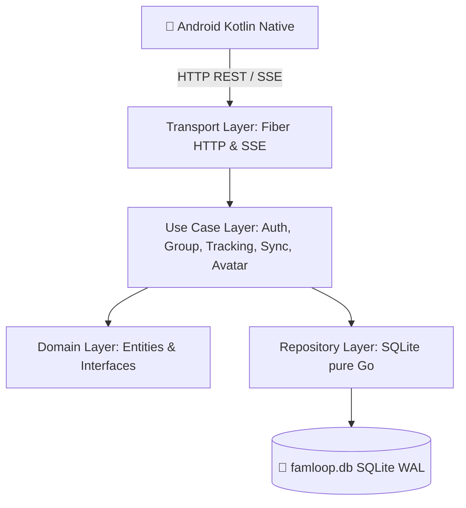

# FamLoop: Arsitektur & Analisis Protokol

## 1. Analisis Protokol: SSE vs MQTT vs WebSocket

Pertanyaan kritis: *"Kadang network dibeberapa tempat firewall memblokir websocket, ada metode server sent event (SSE), better mana?"*

### Perbandingan Karakteristik

| Kriteria | Server-Sent Events (SSE) | WebSocket (WS) | MQTT (TCP 1883) |
|---|---|---|---|
| **Protokol Dasar** | HTTP/1.1 atau HTTP/2 standar | Protokol kustom via Upgrade | Protokol biner TCP murni |
| **Tembus Firewall / Proxy** | **99.9% Lolos** (dianggap HTTP biasa) | Sering diblokir proxy/firewall | Port 1883 sering diblokir ISP/hotspot |
| **Arah Komunikasi** | Server ke Client (unidirectional) | Full-duplex (dua arah) | Full-duplex via broker |
| **Beban di Android** | Sangat ringan, native HTTP client | Perlu koneksi WS persistent | Perlu library MQTT client |
| **Auto-reconnect** | Otomatis bawaan protokol | Harus manual di client | Tersedia di client library |
| **Penggunaan Ideal** | **Notifikasi & Live Tracking Peta** | Chat interaktif cepat dua arah | Sensor IoT / Micro-payload |

### Keputusan Arsitektur FamLoop (Hybrid Terbaik)
1. **Downstream (Peta Orang Tua & Anak memantau Anggota)**: Gunakan **Server-Sent Events (SSE)**.
   - Port 80/443 standar HTTP.
   - Lolos dari semua jenis firewall kampus, kantor, maupun operator seluler.
   - Heartbeat `: ping` tiap 15 detik menjaga koneksi tetap hidup (*keep-alive*).
2. **Upstream (Hp Anggota kirim koordinat)**: Gunakan **HTTP POST** (`/api/v1/tracking/ping` atau batch upload).
   - Stateless, mudah di-retry, dan hemat baterai.
3. **MQTT (Opsional / Secondary)**: Tetap sediakan port 1883 untuk perangkat yang mendukung, tetapi jalur utama aplikasi mobile dialihkan ke **SSE + HTTP REST** demi keandalan maksimal di semua jaringan.

---

## 2. Arsitektur Bersih (Clean Architecture)



### Aturan Ketergantungan (Dependency Rule)
- **Domain**: Tidak memiliki ketergantungan pada SQLite, Fiber, atau framework manapun.
- **Use Case**: Menjalankan alur bisnis murni (pairing device, hitung jarak, validasi koordinat, upload avatar).
- **Repository**: Implementasi SQL mentah menggunakan driver pure Go `modernc.org/sqlite`.
- **Transport**: Controller HTTP Fiber dan streaming SSE.

---

## 3. Sistem Avatar & Foto Profil (Default Random Karakter + Custom Upload)

1. **Default Karakter Acak**:
   - Jika pengguna orang tua atau perangkat anak baru bergabung tanpa foto, sistem otomatis menetapkan salah satu dari 12 karakter kartun default (`char_lion`, `char_bear`, `char_cat`, `char_fox`, `char_rabbit`, `char_panda`, `char_koala`, `char_tiger`, dll).
   - Karakter default ini dibundel di dalam aplikasi Android sebagai asset SVG/vektor ringan.
2. **Upload Foto Profil (PP) Kustom**:
   - Baik hp orang tua maupun hp anak dapat mengunggah foto profil kustom melalui endpoint multipart form data.
   - File disimpan di folder server `uploads/avatars/` dan disajikan melalui URL statis.
   - Saat foto profil diubah, server mengirim event SSE `MemberAvatarUpdated` ke seluruh hp di dalam grup keluarga sehingga marker di peta Leaflet langsung berganti secara real time.

---

## 4. Schema Database (SQLite WAL Mode)

```sql
PRAGMA journal_mode = WAL;
PRAGMA busy_timeout = 5000;
PRAGMA foreign_keys = ON;

CREATE TABLE IF NOT EXISTS users (
    id TEXT PRIMARY KEY,
    username TEXT NOT NULL UNIQUE,
    email TEXT NOT NULL UNIQUE,
    phone_number TEXT NOT NULL UNIQUE,
    avatar TEXT DEFAULT '',
    password_hash TEXT NOT NULL,
    created_at DATETIME DEFAULT CURRENT_TIMESTAMP,
    updated_at DATETIME DEFAULT CURRENT_TIMESTAMP
);

CREATE TABLE IF NOT EXISTS family_groups (
    id TEXT PRIMARY KEY,
    name TEXT NOT NULL,
    parent_id TEXT NOT NULL,
    invite_code TEXT UNIQUE,
    created_at DATETIME DEFAULT CURRENT_TIMESTAMP,
    FOREIGN KEY (parent_id) REFERENCES users(id) ON DELETE CASCADE
);

CREATE TABLE IF NOT EXISTS member_devices (
    id TEXT PRIMARY KEY,
    group_id TEXT NOT NULL,
    device_uuid TEXT NOT NULL,
    device_name TEXT NOT NULL,
    avatar TEXT DEFAULT '',
    ipv4 TEXT,
    ipv6 TEXT,
    mac_address TEXT,
    battery_level INTEGER DEFAULT 100,
    is_active INTEGER DEFAULT 1,
    paired_at DATETIME DEFAULT CURRENT_TIMESTAMP,
    last_seen_at DATETIME,
    UNIQUE(group_id, device_uuid),
    FOREIGN KEY (group_id) REFERENCES family_groups(id) ON DELETE CASCADE
);

CREATE TABLE IF NOT EXISTS location_history (
    id INTEGER PRIMARY KEY AUTOINCREMENT,
    device_id TEXT NOT NULL,
    group_id TEXT NOT NULL,
    latitude REAL NOT NULL,
    longitude REAL NOT NULL,
    accuracy REAL DEFAULT 0.0,
    speed REAL DEFAULT 0.0,
    heading REAL DEFAULT 0.0,
    recorded_at INTEGER NOT NULL,
    synced_at DATETIME DEFAULT CURRENT_TIMESTAMP,
    FOREIGN KEY (device_id) REFERENCES member_devices(id) ON DELETE CASCADE,
    FOREIGN KEY (group_id) REFERENCES family_groups(id) ON DELETE CASCADE
);

CREATE INDEX IF NOT EXISTS idx_loc_group_time ON location_history(group_id, recorded_at DESC);
CREATE INDEX IF NOT EXISTS idx_loc_device_time ON location_history(device_id, recorded_at DESC);
CREATE UNIQUE INDEX IF NOT EXISTS idx_loc_dedup ON location_history(device_id, recorded_at);
```
